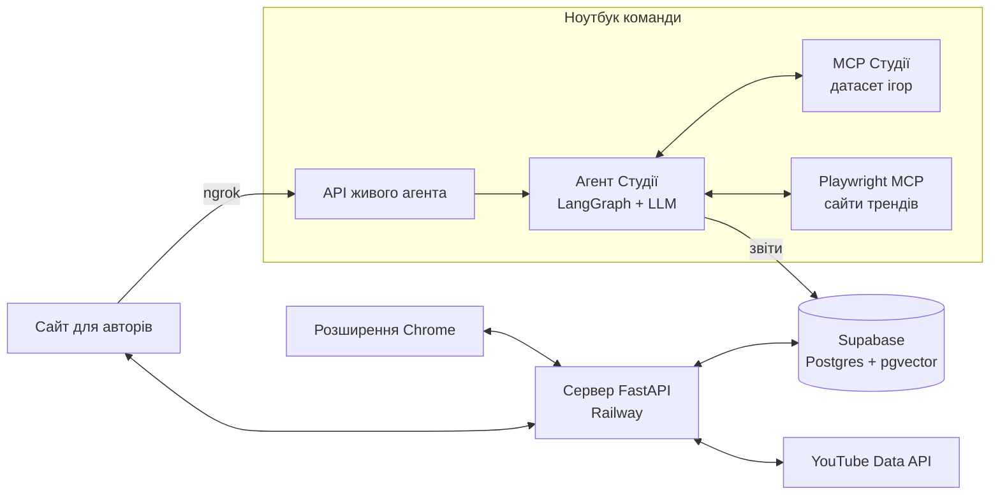

# Мовний фід

**Допомагаємо українському YouTube рости з двох боків: глядачам — знаходити українські відео замість російських, креаторам — знати, що знімати.**

Культурний хакатон OBRIO × МУР · трек: Мова-Мистецтво · фінал 21.11.2026

| | Посилання |
|---|---|
| Спробувати AI-агента наживо (QR для журі) | https://movnyi-feed-production.up.railway.app/creators/studio/try |
| Звіти AI-агента | https://movnyi-feed-production.up.railway.app/creators/studio |
| Попит глядачів для авторів | https://movnyi-feed-production.up.railway.app/creators |
| Розширення для Chrome | папка [`extension/`](extension/), встановлення нижче |
| Відео-демо | https://drive.google.com/file/d/1pBUeEzj2nBltovM9QWfPHu5ar_GeIN8L/view?usp=sharing |
| Презентація | https://claude.ai/artifact/LEUneASN95jKJ7VcyHWJPB#slide-3dd33bdac6c2 |
| Посилання на репозиторій GitHub | https://github.com/andriiboichuk13/movnyi-feed |

## Проблема

Глядач, який хоче дивитися українською, на YouTube щодня бачить у рекомендаціях російськомовні відео: українського відповідника або немає, або алгоритм його не показує. Креатор, який хоче знімати українською, не знає, які теми вже популярні у світі, але ще не мають українських відео, і витрачає години на ручний пошук.

Частка української на YouTube росте, але нерівно: за дослідженням Detector Media / SubSub Analytics, у категорії «Розваги» вона 65%, у дитячій - 94%, а в ігрових і розважальних нішах контенту досі бракує. Ресурси і визнання в docs/research/: ([наша валідація ринку](docs/research/)).

## Що ми зробили

### Для глядачів: розширення для Chrome

- **Панель альтернатив.** На російськомовному відео праворуч з'являється до 3 українських відео на ту саму тему, з підписом, наскільки вони близькі («та сама тема», «близька тема», «англійською»).
- **«Хочу українське».** Якщо відповідника немає, глядач пише, що хотів би подивитися. Ці запити стають даними для авторів.
- **Дитячий режим.** Ховає російськомовні відео на головній, у рекомендаціях і пошуку; PIN на вимкнення.

### Для креаторів: сайт «Для авторів» і Студія ідей

- **[Попит глядачів](https://movnyi-feed-production.up.railway.app/creators):** запити «Хочу українське», розкладені NLP за темами: що глядачі просять і для чого немає українського відео.
- **[Студія ідей](https://movnyi-feed-production.up.railway.app/creators/studio/try):** AI-агент. Креатор пише «Хочу знімати Minecraft, люблю будувати міста», а агент сам:
  1. відкриває сайти трендів (minecraft.net, Modrinth, чарти Steam і Roblox);
  2. перевіряє на датасеті ~1 900 ігрових відео, що популярне англійською й російською, але не має українського відповідника;
  3. оцінює 3-6 ідей за попитом, конкуренцією й свіжістю;
  4. пише структуру сценарію, назву, опис і теги українською та перевіряє їх.

  Кожна цифра у звіті - з інструментів агента, з посиланнями на відео-докази.

## Що працює, а що заглушка

| Частина | Стан |
|---|---|
| Розширення: панель альтернатив, «Хочу українське», дитячий режим, popup | ✅ працює; встановлюється з папки (Chrome Web Store - після хакатону) |
| Сервер у хмарі (Railway): визначення мови, підбір альтернатив, збір запитів і подій | ✅ працює, але потрібні гроші на підтримку працезданості |
| Каталог: ~600 україномовних каналів, ~29 000 відео | ✅ працює |
| Сайт «Попит глядачів» з NLP-аналітикою запитів | ✅ працює |
| Студія: AI-агент із двома MCP-серверами, звіти на сайті | ✅ працює |
| Живий запуск агента з сайту (QR) | ⚠️ працює, але агент запущений на ноутбуці команди й доступний через ngrok; якщо ноутбук офлайн, сторінка показує готові звіти |
| Датасет Студії | ✅ 8 ігор присутні (Minecraft, Roblox, CS2, Dota 2, Fortnite, GTA, Valorant, Brawl Stars), знімок від 20.11.2026 |
| Аналіз каналу креатора, перевірка відео перед публікацією, пости для соцмереж, поради після публікації | 🧩 заглушки: макети в презентації, у продукті ще немає |
| Сповіщення про нові тренди, мобільний застосунок YouTube | 🧩 план розвитку |

## Як це працює



**Підбір альтернатив.** Відео перетворюються на багатомовні ембединги `multilingual-e5-small`, тож російське відео й українські відео на ту саму тему мають близькі вектори без перекладу. Сервер шукає найближчі в індексі pgvector (HNSW), враховує окремо схожість назв і назв з описами (опис очищається від реклами й посилань), а коли в каталозі нічого немає - шукає на YouTube українською, потім англійською. Мова відео визначається каскадом: літери, службові слова, метадані YouTube; поріг упевненості 0,8, бо сховати українське відео гірше, ніж пропустити російське.

**Студія.** Агент - LangChain `create_agent` (граф LangGraph), модель через OpenRouter (за замовчуванням `anthropic/claude-haiku-5.5`). Власний MCP-сервер на FastMCP дає 5 інструментів над локальним датасетом: покриття ніші, пошук прогалин (кластеризація іноземних відео + порівняння з українськими), оцінка ідеї за явними правилами, перевірка пакування відео й збереження плану. Playwright MCP дає браузер лише для читання дозволених сайтів трендів.

### Як ми боремося з вигадками AI

- Усі цифри у звітах (перегляди, кількість відео, схожість) - лише з результатів інструментів; системний промпт це вимагає, а звіт посилається на відео-докази.
- Факти про гру (патчі, персонажі, турніри) - лише з назв відео чи сторінок трендів; інакше агент формулює загально. Правило додали після того, як помітили вигаданий номер патча на тестах.
- Висновки інструментів мають явні правила й пороги (`studio/mcp_server/rules.py`), які видно в кожному результаті.
- Гру, якої немає в датасеті, агент чесно називає непідтримуваною й не вигадує аналіз.
- Пакування відео перевіряє детермінований інструмент (ліміти YouTube, українська мова без російських літер); агент виправляє й перевіряє знову.
- Браузер відкриває лише дозволені сайти; знімки сторінок обрізаються, щоб агент не «читав» зайвого.
- Якщо інструмент чи браузер недоступний, агент пише про це у звіті й продовжує з тим, що є.

## Стек

| Шар | Технології |
|---|---|
| Розширення | Chrome Manifest V3, JavaScript без збірки, Shadow DOM |
| Сервер | Python 3.12, FastAPI, psycopg, sentence-transformers (`intfloat/multilingual-e5-small`, MIT), PyTorch CPU |
| База | Supabase: Postgres + pgvector (HNSW) |
| NLP запитів | scikit-learn (кластеризація), NER `Babelscape/wikineural-multilingual-ner` |
| Агент | LangChain / LangGraph, OpenRouter, FastMCP 3, langchain-mcp-adapters, Playwright MCP (Microsoft) |
| Хостинг | Railway (сервер і сайт), ngrok (живий агент з ноутбука) |
| Дані | YouTube Data API v3, Google-таблиця каталогу каналів |

## Як запустити

**Розширення (без Git і Python):** GitHub → Code → Download ZIP → `chrome://extensions` → «Режим розробника» → «Завантажити розпаковане» → папка `extension`. Розширення вже ходить на сервер у хмарі.

**Сервер і скрипти:**

```bash
git clone https://github.com/andriiboichuk13/movnyi-feed.git
cd movnyi-feed
python -m venv backend/.venv
backend/.venv/bin/python -m pip install -r backend/requirements.txt -r studio/requirements.txt   # Windows: backend\.venv\Scripts\python
```

Секрети (`YOUTUBE_API_KEY`, `DATABASE_URL`, `CHANNELS_SHEET`, `OPENROUTER_API_KEY`, `STUDIO_MODEL`) — у `backend/.env`, у репозиторій не потрапляють. Детально:

- сервер, наповнення каталогу, деплой — [`backend/README.md`](backend/README.md);
- Студія: датасет, MCP-сервер, агент, живий запуск — [`studio/README.md`](studio/README.md);
- розширення — [`extension/README.md`](extension/README.md).

## Джерела даних і права

| Джерело | Як використовуємо | Права й обмеження |
|---|---|---|
| YouTube Data API v3 | метадані відео (назва, опис, теги, перегляди), пошук | [Умови YouTube API](https://developers.google.com/youtube/terms/api-services-terms-of-service); дані оновлюються або видаляються щонайменше раз на 30 днів; датасет Студії не публікується в репозиторії |
| Рейтинг україномовних каналів [«Маніфест»](https://manifest.in.ua) | підказка для каталогу каналів | до каталогу потрапляють лише канали, яким команда вручну поставила статус `approved`; мову кожного відео додатково перевіряє скрипт |
| minecraft.net, modrinth.com, store.steampowered.com, roblox.com/charts | агент читає публічні сторінки трендів | лише читання, без входу й форм |
| `intfloat/multilingual-e5-small` | ембединги | MIT |
| `Babelscape/wikineural-multilingual-ner` | розпізнавання назв у запитах | ліцензія моделі на Hugging Face |
| Playwright MCP | браузер для агента | Apache-2.0 |

## Що згенерував AI, а що перевірила людина

- **Вирішує людина:** які канали входять до каталогу (статус `approved` у таблиці), пороги й правила підбору (калібрувалися на реальних прикладах), звіти Студії перед ручною публікацією.
- **Автоматично, з явними правилами:** визначення мови, підбір альтернатив, оцінки ідей у Студії.
- **Генерує LLM:** текст звітів Студії, ідеї, структури сценаріїв, назви й описи. На сайті вони позначені як звіти агента, а цифри в них — з даних. Живі запуски з QR публікуються автоматично; ми переглядаємо їх і прибираємо невдалі.

## Дані користувачів

Розширення не знає, хто користувач: лише випадковий `installId`, створений при встановленні. Сервер зберігає події (показ панелі, клік на альтернативу), запити «Хочу українське» і id відео, які розширення запропонувало чи сховало. Даних Google-акаунта ми не збираємо. Тексти запитів на сайт для авторів не віддаються, лише теми.

## Валідація ринку

Наші дослідження — у [`docs/research/`](docs/research/):

- **Попит на ШІ серед креаторів є:** за глобальними опитуваннями (Epidemic Sound, Adobe, Kolsquare, CreatorIQ) більшість креаторів уже використовують ШІ, найчастіше — для ідей і сценаріїв.
- **В Україні біль гостріший:** медіанний RPM українського YouTube - $2,30-4 за 1 000 переглядів проти $10-20 у США, тож автор не може утримувати команду для пошуку тем і продакшну.
- **Прямого конкурента не знайшли:** vidIQ, TubeBuddy, Google Trends і YouTube Studio закривають окремі кроки, але не пошук «популярне у світі → немає українською».
- **Що ще не доведено:** готовність українських креаторів платити. Наступний крок - 30-50 інтерв'ю з креаторами різних ніш і розмірів.

## План розвитку

- **3 місяці:** Студія в хмарі з кнопкою «Запустити» без ноутбука команди; розширення в Chrome Web Store; сторінка конфіденційності; більше ігор у датасеті; інтерв'ю з 30-50 креаторами.
- **6 місяців:** аналіз каналу креатора; перевірка відео перед публікацією; пости для соцмереж; сповіщення про нові тренди; інші ніші окрім ігор.
- **12 місяців:** робота з агенціями й MCN; вплив на мобільний застосунок YouTube через сигнали акаунта (підписки, «Переглянути пізніше»); партнерства з українськими каналами.

## Команда

- Бойчук Андрій — розширення, сервер, AI-агент Студії
- Капранов Марко — NLP-аналітика запитів, сайт для авторів
- Уткін Микола — тестування, каталог каналів
- Василенко Ілля — дослідження ринку, презентація
- Лук'янець Іван — менеджмент, презентація

## Безпека

Ключі API лише в змінних середовища (`backend/.env` локально, Variables на Railway), у репозиторії їх немає. Живий агент обмежений: 2 запуски одночасно, 4 на годину з одного пристрою, 60 на день.
